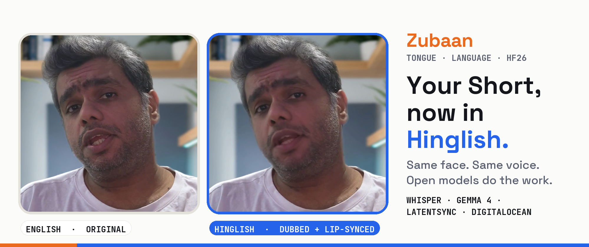

# Zubaan

*Zubaan* (zu-baan) is Hindi for "tongue", and also for "language". This tool changes both.

Turn an English YouTube Short into a Hinglish one, with the creator's own face and voice.
Open models handle the transcript, translation and lip sync, and the only closed piece is the creator's voice clone.

Built for the [Hacktoberfest Open-Source AI Challenge, Week 2: Side Hustle](https://dev.to/challenges/hacktoberfest-week2-2026-10-12),
on Shorts from my channel [Grounded AI Lab](https://youtube.com/@groundedailab).



## Pipeline

| Step | Tool | Open? | Runs on |
|---|---|---|---|
| English speech → timed transcript | [faster-whisper](https://github.com/SYSTRAN/faster-whisper) `small.en` | Open (MIT) | Laptop CPU, 70 s of audio in ~31 s |
| Transcript → spoken Hinglish, line by line | **Gemma 4 31B** via DigitalOcean Serverless Inference | Open weights (Apache 2.0) | DigitalOcean |
| Hinglish → creator's voice + word timings | ElevenLabs voice clone (`eleven_v4`) | Closed | ElevenLabs API |
| Face video → lips that match the Hinglish | [LatentSync 1.5](https://github.com/bytedance/LatentSync) | Open (Apache 2.0 code, OpenRAIL++ weights) | RTX 3060 12 GB (WSL) |
| Re-render with Hinglish captions, music, SFX | [HyperFrames](https://hyperframes.heygen.com) + ffmpeg | Open | Laptop |

Two details that made the output usable:

- **On-screen text as a glossary.** Whisper hears "GPT-6 Astra" as "Astra 6" and "Jev" as "Gev". `dub.py` pulls the
  video's own overlay text out of the composition and gives it to Gemma as the source of truth for names, so each video
  corrects its own spellings with no hand-written hints.
- **Timing-aware placement.** Each Hinglish line starts where its English line started, and is sped up by at most 15 %
  when it would run into the next one, so the existing cards and cuts still land on the right words.

## Usage

```bash
pip install -r requirements.txt
# .env (or environment): DIGITALOCEAN_TOKEN, ELEVENLABS_API_KEY, ELEVENLABS_VOICE_ID (your own clone)

python dub.py path/to/short --style path/to/a_hinglish_script.txt     # transcript, translation, voice, audio-only dub
bash lipsync.sh path/to/short/assets/base.mp4 out/<short>/voice_only_16k.wav out/<short>/base_hinglish.mp4 "8.72 21 37.4"
#   ^ cut points (seconds) at pauses between lines: LatentSync holds every frame in RAM, so long videos go in chunks
python recaption.py path/to/short out/<short>/base_hinglish.mp4        # re-render with lip-synced face + Hinglish captions
```

A "short" here is a HyperFrames composition folder: `index.html`, `assets/base.mp4` (face), `assets/voice.wav`,
`assets/music.wav`, `renders/*.mp4`. Every stage is cached on disk, so a rerun only redoes what changed.

## Cost per 70-second Short

| | Usage | Cost |
|---|---|---|
| Gemma 4 on DigitalOcean | ~1,100 tokens | under ₹1 |
| ElevenLabs | ~1,000 characters | inside the Creator plan |
| Whisper, LatentSync, render | local GPU / CPU | ₹0 |

## Consent

This tool is for dubbing **your own** face and voice. The voice step uses your own ElevenLabs clone, and lip sync only
runs on footage you supply. Mark the result as altered or synthetic content where the platform asks (YouTube does).

## Credits

LatentSync (ByteDance), faster-whisper (SYSTRAN, on OpenAI Whisper), Gemma (Google DeepMind), HyperFrames (HeyGen).
The Short compositions and their style come from my earlier Grounded AI Lab pipeline. This repo is the new dubbing
layer, built 14–18 Oct 2026.

MIT licensed.
